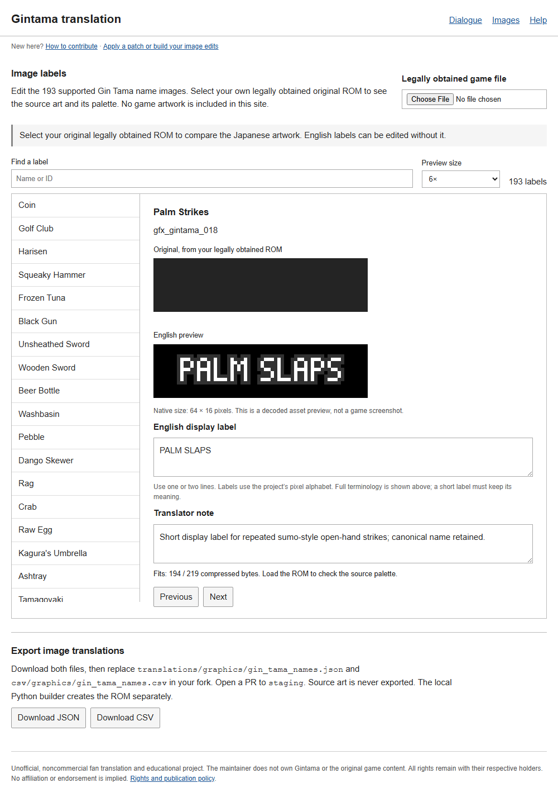

# How to contribute

You do not need to code to help translate. Edit one record, click **Suggest on GitHub**, and submit the prepared issue.

You need a GitHub account to submit a contribution and your own legally obtained, matching ROM to check the Japanese. The browser reads the ROM locally; it is not uploaded. No Python or Git installation is needed.

## Suggest one dialogue line

1. Open the [dialogue editor](https://zthegin.github.io/) and choose your game file.
2. Choose a **Batch**, then select a line from the list.
3. Write the English. Keep the page count shown above the text box; type `\f` for a page break. Give every page some text. Add a translator note if anything is uncertain.
4. Click **Suggest on GitHub**. Check the prepared English and note, then submit the issue on GitHub.

That is your part done. The issue contains one record for review. A maintainer checks the wording and local build before accepting it; nothing publishes automatically. Accepted suggestions are credited to the GitHub account that opened the issue. This route needs no fork, branch or file upload.

If no GitHub tab opens, click **Open the prepared suggestion** below the button.

## Suggest an opening-cutscene line

Use the [Opening editor](https://zthegin.github.io/cutscenes.html) for the indexed entries in the first cutscene. Select your legally obtained original ROM, choose an entry, and edit its English parts. Keep their count and order. Click **Suggest on GitHub**, check the prepared issue and submit it. No coding is required. These suggestions do not use the field-dialogue JSON/CSV batch route below. Other adventure cutscenes are not supported yet.

Keep **Yorozuya**, **Gin Tama** and character names consistent. If you only proofread the English without checking the Japanese, say so in your note. The [translation notes](TRANSLATION_GUIDE.md) cover wording; the [game and anime background](ABOUT_THE_GAME.md) introduces the setting.

## Suggest one image label

Open [Images](https://zthegin.github.io/graphics.html), select your own legally obtained original ROM and choose a name label. Edit the English, check the native-size preview and wait for **Fits**. Use **Suggest on GitHub** to submit that record. A maintainer also checks the compressed label against its game slot before accepting it.

## Submit a batch or image label

Use this optional route for several field-dialogue lines or image labels together. For one record, a suggestion is easier.

1. Make your edits in the editor. For image labels, check the native-size preview and wait for **Fits**.
2. Download **both JSON and CSV** for the same batch. Drafts otherwise stay only in that browser.
3. Open the [project repository](https://github.com/zthegin/Gintama---Gintoki-vs-Hijikata-game-english-translation), click **Fork**, and uncheck **Copy the main branch only** so your fork includes `staging`.
4. In your fork, select **staging** in the branch menu. If GitHub offers **Sync fork → Update branch**, use it first. Then create your contribution branch from `staging`.
5. Open the matching folder below, choose **Add file → Upload files**, upload the JSON and commit it to your contribution branch. Do the same for the CSV in its folder. If the batch has changed since the website was built, carry over only your own edits.
6. Choose **Contribute → Open pull request**. Set the original repository’s **staging** branch as the base. Check **Files changed**, describe your edits and submit.

| What you edited | JSON goes here | CSV goes here |
| --- | --- | --- |
| Dialogue batch `batch_0001` | `translations/ready/batch_0001.json` | `csv/ready/batch_0001.csv` |
| Image labels | `translations/graphics/gin_tama_names.json` | `csv/graphics/gin_tama_names.csv` |

For other dialogue batches, keep their existing filenames and folders. Remove any `(1)` suffix added by your browser. Leave IDs, hashes, record order and page counts unchanged.

Other GitHub users can review your PR without joining a reviewer list. Two approvals on the current revision put valid translation edits in the reviewed queue for the owner's attention. The owner merges manually into `staging`, then decides what reaches `main`. Nothing merges automatically. If reviewers request changes, update the same branch and upload both files again. New commits need new approvals. You do not need to edit `TRANSLATORS.md`.

Submit English and notes only. Keep ROMs, Japanese script dumps and game captures private. See [contribution terms](../RIGHTS.md).

<details>
<summary>See an image-label example</summary>



Editor preview with no game file loaded.

</details>

## If something goes wrong

- **A label does not fit:** shorten it or use two lines.
- **JSON/CSV checks fail:** download both files again from the same editor state.
- **A dialogue build says the text is too long:** shorten it in the editor, keep the page count and download both files again. The browser checks page breaks; Python checks the final fit.
- **The website is unavailable:** use the local editor below.
- **You want to build the translated UI:** follow [installation](APPLY_PATCH.md). The build applies the bundled English dialogue too. To test a downloaded JSON batch, use the `--dialogue` option described there.

## Run the editor locally

Use Python 3.13 (3.11 is also tested), extract the project source ZIP and open a terminal in its folder. On Windows, type `powershell` in File Explorer’s address bar and press Enter. The commands below use the Windows Python launcher. On macOS/Linux, use `python3.13` instead of `py -3.13`.

```sh
py -3.13 tools/build_web.py --out ../editor-site
py -3.13 -m http.server 8000 --bind 127.0.0.1 --directory ../editor-site
```

Open `http://127.0.0.1:8000/`. Keep the terminal running; Ctrl+C stops the server.

The maintainer does not own Gintama or any original game content. All game rights remain with their respective holders.

---

This is an unofficial fan and educational translation of *Gintama: Gintoki vs. Hijikata!? Kabukichou Gintama Dai Soudatsusen!!* for Nintendo DS. I do not own the game or its original content. Use only your own legally obtained ROM. See [rights and project limits](../RIGHTS.md).

## Battle dialogue (no code)

Open [Battle](https://zthegin.github.io/battle.html), choose a script and select your own legally obtained original ROM. Choose an entry, write the English and click **Suggest on GitHub**. The Japanese is decoded locally and is never included in the issue or downloaded JSON. Unknown glyphs are marked, so check those in your own game before translating.

The editor supports END-terminated messages in 90 battle scripts. Records with embedded tables or page controls, and trailing null-terminated labels, remain unchanged. A script's entry count includes untranslated records and repeated variants; it is not a translation percentage.

Download `battle_translations.json` to test several edits with `--battle`. For a no-code contribution, send one record through **Suggest on GitHub**. For a batch PR, see the [opening and battle export instructions](BROWSER_EDITOR.md). Both routes need owner review and a local fit check before publication.
